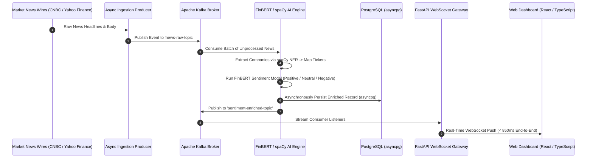

# Real-Time Financial AI Intelligence & Sentiment Streaming Platform


A distributed, event-driven financial intelligence engine built to consume live market news feeds, extract company entities and tickers, calculate financial sentiment polarity using FinBERT, and stream actionable market signals over WebSockets with sub-second end-to-end latency.

---

## 🏛️ Event Pipeline Architecture



---

## 🔬 Technical Components

1. **Distributed Event Ingestion:** Asynchronous workers poll major news wires and publish raw ingestion events to Apache Kafka topics.
2. **Entity & Ticker Mapping (spaCy NER):** Extracts corporate entities from noisy headlines and resolves them against stock exchange ticker universes.
3. **FinBERT Tensor Inference:** Utilizes ProsusAI's fine-tuned `FinBERT` transformer to generate domain-accurate financial sentiment classifications and confidence scores.
4. **Asynchronous Persistence & WebSocket Broadcast:** High-throughput async database writes via `asyncpg` paired with persistent FastAPI WebSocket connections streaming signals to frontend subscribers.

---

## 📁 Repository Structure

```
financial-ai-platform/
└── financial-project/
    ├── backend/
    │   ├── ai_engine/         # Kafka consumer, spaCy NER, and FinBERT processor
    │   │   ├── consumer.py    # Main Kafka consumer loop
    │   │   ├── entity_extractor.py # Named Entity Recognition
    │   │   └── sentiment.py   # FinBERT inference module
    │   ├── api/               # FastAPI routes and WebSocket hub
    │   │   ├── main.py        # Gateway server entrypoint
    │   │   ├── routes.py      # REST endpoints for historical analysis
    │   │   └── websocket.py   # Live WebSocket connection manager
    │   └── common/            # Configuration and database pooling
    ├── docker-compose.yml     # Kafka, Zookeeper, and PostgreSQL topology
    └── requirements.txt       # Python dependencies
```

---

## 🚀 Quickstart & Deployment

### 1. Clone & Start Infrastructure
```bash
git clone https://github.com/sultanriaz/financial-ai-platform.git
cd financial-ai-platform/financial-project
docker compose up -d
```

### 2. Set Up Python Virtual Environment
```bash
python -m venv venv
# Linux / macOS:
source venv/bin/activate
# Windows:
.\venv\Scripts\Activate.ps1

pip install -r requirements.txt
```

### 3. Launch the API & AI Consumer
```bash
# Start the FastAPI WebSocket server:
python backend/api/main.py

# In a separate terminal, launch the AI streaming consumer:
python backend/ai_engine/consumer.py
```
